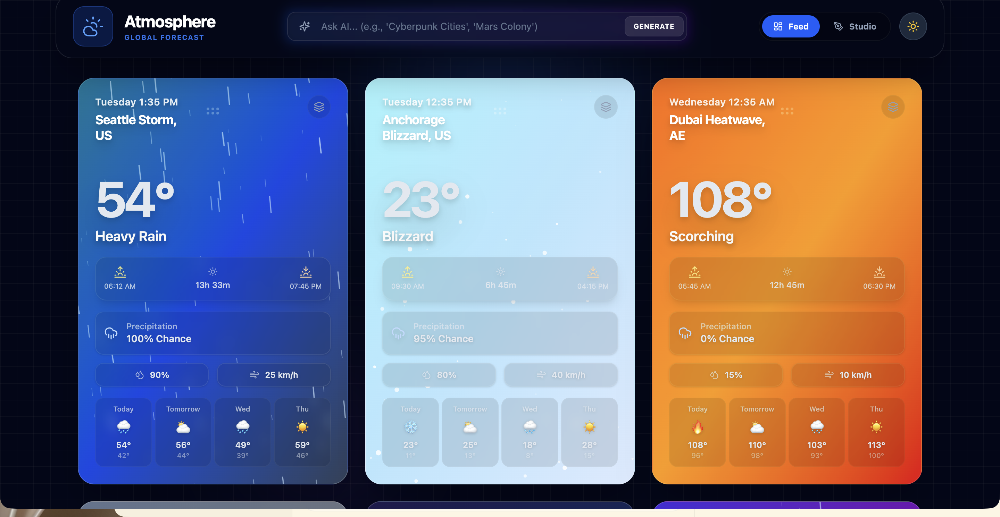
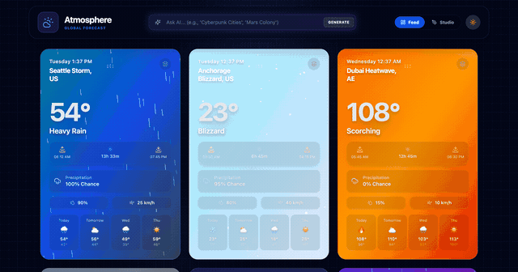
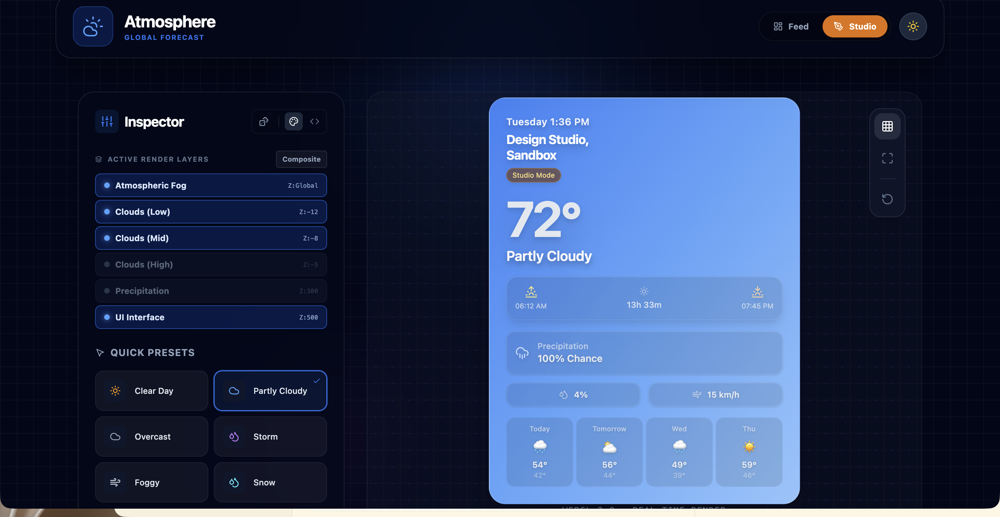

# Atmosphere

A weather dashboard where every card is a real-time WebGL scene — procedural cloud shaders, animated rain and snow, moon phases, and an AI prompt bar that generates entire themed worlds via Gemini.



## Quick Start

```bash
git clone https://github.com/AndrewVoirol/ais-atmosphere.git
cd ais-atmosphere
npm install --legacy-peer-deps
npm run dev
```

> Requires Node.js 18+. For AI features, add your Gemini API key to `.env.local` — see [Setup](#gemini-api-setup) below.

## What It Does

**Feed View** — A 3×3 grid of weather cards. Each card renders its own 3D cloud system, particle-based precipitation (rain, snow, fog), sunrise/sunset data, moon phase, and a 4-day forecast. Cards are drag-to-reorder. Click the layers icon on any card to explode it into its rendering layers (gradient → clouds → precipitation → UI).

**Studio View** — A live design tool for crafting weather scenes. Sliders for cloud coverage, density, speed, and fog. Day/night toggle. Weather presets. Custom gradient and cloud tint pickers. Exports the current config as JSON.

**AI Generation** — Type a theme ("Cyberpunk Cities", "Mars Colony", "Mediterranean Summer") and Gemini generates 9 themed locations with conditions, replacing the grid in real time.

## Screenshots




## How It Works

Type a theme into the prompt bar and hit Generate. Gemini returns structured JSON (9 cities with weather data, conditions, day/night flags), which gets hydrated into full weather cards with themed gradients, cloud configurations, and particle effects.

Under the hood, the 3D scenes use custom GLSL fragment shaders with simplex noise FBM for procedural cloud generation. Each card renders multiple cloud layers at different Z-depths with independently configurable density, coverage, sharpness, and scroll speed. The precipitation system runs on a separate HTML5 Canvas with physics-influenced particles (wind drift, gravity, sway).

## Tech Stack

| Layer | Technology |
|-------|------------|
| Framework | React 18 |
| 3D Rendering | React Three Fiber + Three.js |
| Cloud Shaders | Custom GLSL (simplex noise FBM) |
| 3D Helpers | @react-three/drei |
| Animation | Framer Motion |
| AI | Google Gemini 2.5 Flash (@google/genai) |
| Styling | Tailwind CSS 4 |
| Build | Vite |
| Language | TypeScript |

## Gemini API Setup

1. Get an API key from [Google AI Studio](https://aistudio.google.com/apikey)
2. Create `.env.local` in the project root:
   ```
   VITE_GEMINI_API_KEY=your_key_here
   ```
3. Restart the dev server

The dashboard works without an API key — it loads with 9 sample cities. The AI prompt bar activates when the key is configured.

## License

MIT
